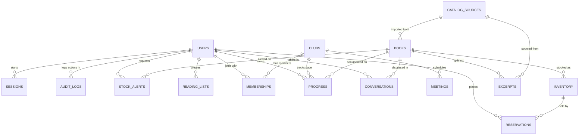

# Booklore data model

Every MongoDB collection used across the app, what fields each holds, and how they connect.

---

## How collections link together

---

## Brief collections

### 1. books

Every title in the bookstore catalog, along with reading pace estimates and search embeddings.

| Field            | Type            | Notes                                                   |
| :--------------- | :-------------- | :------------------------------------------------------ |
| `title`          | String          | Title of the book                                       |
| `authors`        | Array of String | Author names                                            |
| `isbn`           | String          | ISBN identifier                                         |
| `themes`         | Array of String | Book themes (e.g. mystery, identity)                    |
| `moods`          | Array of String | Emotional tones (e.g. cozy, dark, lighthearted)         |
| `synopsis`       | String          | Plot summary                                            |
| `pageCount`      | Number          | Total pages                                             |
| `chapterCount`   | Number          | Total chapters in the book                              |
| `readingHours`   | Number          | Estimated reading time in hours                         |
| `sourceId`       | ObjectId        | Points to the `catalogSources` row it came from         |
| `approvedSource` | Boolean         | Whether the ingestion source is approved                |
| `contentLevel`   | String          | Content age rating or difficulty                        |
| `embedding`      | Array of Number | 768 numbers for Atlas Vector Search (index `books_vec`) |

> **Key Rule & Index:** Has a 768-dimension vector on `embedding` indexed by `books_vec` for semantic search.

---

### 2. catalogSources

Where we import books and excerpts from (distributors, publishers, or internal feeds).

| Field        | Type   | Notes                                              |
| :----------- | :----- | :------------------------------------------------- |
| `name`       | String | Name of the source or provider                     |
| `type`       | String | Source type: `publisher`, `store`, or `synopsis`   |
| `license`    | String | Copyright or data distribution license             |
| `permission` | String | Review status: `approved`, `pending`, or `revoked` |

---

### 3. inventory

Physical copies sitting on the shelf, divided by condition.

| Field           | Type             | Notes                                                             |
| :-------------- | :--------------- | :---------------------------------------------------------------- |
| `bookId`        | ObjectId         | References the book                                               |
| `condition`     | String           | `new` or `used`                                                   |
| `total`         | Number           | Total physical copies owned                                       |
| `available`     | Number           | Copies free to be reserved or bought                              |
| `held`          | Number           | Copies currently locked in an active reservation                  |
| `status`        | String           | `active` or `unavailable`                                         |
| `pickupWindows` | Array of Objects | Array of `{ start, end }` pickup time slots available for readers |

> **Key Rule & Index:** Unique compound index on `{ bookId: 1, condition: 1 }` guarantees exactly one inventory row per book and condition.

---

### 4. reservations

Reader hold requests to pick up books in person.

| Field            | Type     | Notes                                          |
| :--------------- | :------- | :--------------------------------------------- |
| `userId`         | ObjectId | Reader who placed the hold                     |
| `bookId`         | ObjectId | Book being reserved                            |
| `inventoryId`    | ObjectId | Stock item holding the copy                    |
| `condition`      | String   | Reserved condition (`new` or `used`)           |
| `pickupWindowId` | ObjectId | Selected pickup window slot                    |
| `status`         | String   | `held`, `collected`, `cancelled`, or `expired` |
| `expiresAt`      | Date     | When the hold automatically expires            |

---

### 5. readingLists

Custom reader shelves and staff recommendation lists.

| Field        | Type             | Notes                                        |
| :----------- | :--------------- | :------------------------------------------- |
| `ownerId`    | ObjectId         | Reader or staff user who created the list    |
| `name`       | String           | Shelf name                                   |
| `visibility` | String           | `private` or `public`                        |
| `items`      | Array of Objects | Array of `{ bookId, note, addedAt }` entries |

---

### 6. clubs

Discussion groups reading books together.

| Field           | Type              | Notes                                     |
| :-------------- | :---------------- | :---------------------------------------- |
| `name`          | String            | Club name                                 |
| `description`   | String            | Club description and focus                |
| `published`     | Boolean           | Whether the club is visible to the public |
| `rules`         | String            | Club guidelines and discussion etiquette  |
| `moderators`    | Array of ObjectId | Users who can manage the club             |
| `currentBookId` | ObjectId          | Title the club is currently reading       |
| `bookStartedAt` | Date              | Date reading started for the current book |
| `readingPace`   | String            | Expected pace (e.g. chapters per week)    |

---

### 7. memberships

Tracks which readers belong to which clubs.

| Field      | Type     | Notes                     |
| :--------- | :------- | :------------------------ |
| `clubId`   | ObjectId | Club reference            |
| `userId`   | ObjectId | Member user reference     |
| `status`   | String   | `active` or `removed`     |
| `joinedAt` | Date     | Timestamp the user joined |

> **Key Rule & Index:** Unique compound index on `{ clubId: 1, userId: 1 }` prevents duplicate memberships.

---

### 8. progress

Bookmarks saving where each reader is in a book.

| Field        | Type     | Notes                                                     |
| :----------- | :------- | :-------------------------------------------------------- |
| `userId`     | ObjectId | Reader saving the bookmark                                |
| `bookId`     | ObjectId | Book being read                                           |
| `clubId`     | ObjectId | Optional club context                                     |
| `chapter`    | Number   | Last chapter reached                                      |
| `page`       | Number   | Optional page number                                      |
| `visibility` | String   | Who can see this bookmark: `private`, `club`, or `public` |

> **Key Rule & Index:** Unique compound index on `{ userId: 1, bookId: 1 }` enforces exactly one progress record per reader per book.

---

### 9. excerpts

Portions of book text used for RAG responses while respecting spoiler cutoffs.

| Field        | Type            | Notes                                  |
| :----------- | :-------------- | :------------------------------------- |
| `bookId`     | ObjectId        | Book reference                         |
| `sourceId`   | ObjectId        | Sourced feed reference                 |
| `text`       | String          | Body text of the chunk                 |
| `chapter`    | Number          | Chapter number for spoiler safety      |
| `pageStart`  | Number          | Starting page number                   |
| `pageEnd`    | Number          | Ending page number                     |
| `approved`   | Boolean         | Verified for use in AI answers         |
| `approvedBy` | ObjectId        | Staff user who approved the text       |
| `embedding`  | Array of Number | Vector embedding for excerpt retrieval |

> **Key Rule & Index:** Excerpts explicitly carry `chapter` numbers so the chat bot can block spoilers past the reader's current bookmark.

---

### 10. conversations

Stored chat threads with the Chapter Chat and Next Read agents.

| Field      | Type             | Notes                                                     |
| :--------- | :--------------- | :-------------------------------------------------------- |
| `userId`   | ObjectId         | User asking questions                                     |
| `kind`     | String           | Chat context: `book` (Chapter Chat) or `shop` (Next Read) |
| `bookId`   | ObjectId         | Book being discussed (for `kind: "book"`)                 |
| `clubId`   | ObjectId         | Club context if opened inside a club                      |
| `messages` | Array of Objects | Array of `{ role, text, status, citations, at }`          |

---

## Extra project collections

### 11. users

Reader and staff accounts.

| Field               | Type              | Notes                                                   |
| :------------------ | :---------------- | :------------------------------------------------------ |
| `name`              | String            | User display name                                       |
| `email`             | String            | Unique login email address                              |
| `passwordHash`      | String            | Hashed password                                         |
| `emailVerifiedAt`   | Date              | When the email was confirmed                            |
| `roles`             | Array of String   | Assigned roles: `reader`, `bookseller`, `admin`         |
| `moderatorOf`       | Array of ObjectId | Clubs this user has moderation rights for               |
| `preferences`       | Object            | Saved settings (e.g. default bookmark visibility)       |
| `spoilerSettings`   | Object            | Preferred spoiler strictness across the app             |
| `passwordChangedAt` | Date              | Invalidates any session logged in before this timestamp |

---

### 12. meetings

Scheduled book club meetups.

| Field          | Type     | Notes                               |
| :------------- | :------- | :---------------------------------- |
| `clubId`       | ObjectId | Club holding the meetup             |
| `date`         | String   | Meeting date                        |
| `time`         | String   | Meeting time                        |
| `location`     | String   | Physical room or online link        |
| `bookId`       | ObjectId | Book to discuss                     |
| `agenda`       | String   | Topics to cover                     |
| `chapterRange` | String   | Assigned chapters for the meeting   |
| `createdBy`    | ObjectId | Moderator who organized the meeting |

---

### 13. storeDocs

Bookstore store policies, pickup hours, and FAQs for the store assistant agent.

| Field        | Type            | Notes                                      |
| :----------- | :-------------- | :----------------------------------------- |
| `title`      | String          | Document title                             |
| `type`       | String          | Category: `policy`, `event`, or `faq`      |
| `text`       | String          | Store policy or FAQ content                |
| `chunkIndex` | Number          | Chunk sequence number                      |
| `embedding`  | Array of Number | Vector embedding for store document search |

---

### 14. alerts (StockAlert)

Restock notifications requested by readers.

| Field    | Type     | Notes                               |
| :------- | :------- | :---------------------------------- |
| `userId` | ObjectId | Reader waiting for the book         |
| `bookId` | ObjectId | Book requested                      |
| `status` | String   | `waiting` or `sent`                 |
| `sentAt` | Date     | When the notification was triggered |

---

### 15. auditLogs

Every staff action, recorded for the Logbook.

| Field        | Type     | Notes                                                                |
| :----------- | :------- | :------------------------------------------------------------------- |
| `actorId`    | ObjectId | User who performed the action                                        |
| `action`     | String   | Event name (e.g. `stock.adjust`, `role.change`, `source.permission`) |
| `targetType` | String   | Kind of item changed (e.g. `inventory`, `user`, `catalogSource`)     |
| `targetId`   | ObjectId | ID of the affected document                                          |
| `details`    | Object   | Extra context or diff info                                           |

---

### 16. sessions

Login sessions stored directly by `connect-mongo`.

| Field     | Type            | Notes                                    |
| :-------- | :-------------- | :--------------------------------------- |
| `_id`     | String          | Session cookie identifier                |
| `session` | String / Object | Serialized user ID and login timestamp   |
| `expires` | Date            | Managed automatically by Mongo TTL index |

---

## Important rules and indexes

- **Inventory:** Unique on `bookId + condition` so there is only ever one inventory row for a book's condition.
- **Progress:** Unique on `userId + bookId` so each reader has one bookmark per book.
- **Excerpts:** Always have chapter numbers so Chapter Chat can filter out text past what the reader has read.
- **Books vector search:** `books.embedding` contains 768 dimensions indexed under `books_vec` for semantic search in Atlas.
