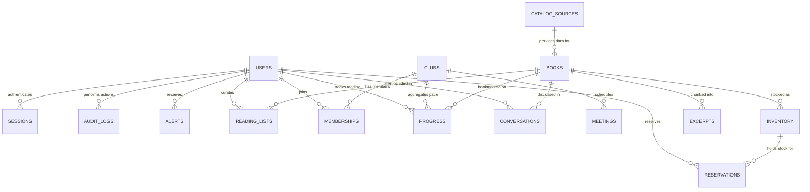

# Bookstore & Clubs Data Model

This document outlines the MongoDB collections used across the bookstore discovery, reading clubs, and AI-assisted reading workflows.

---

## Entity Relationship Overview

---

## Brief Collections

### 1. `books`

Core catalog containing metadata, editorial details, reading duration estimates, and search embeddings.

| Field         | Type            | Notes                                                                     |
| :------------ | :-------------- | :------------------------------------------------------------------------ |
| `_id`         | ObjectId        | Primary key                                                               |
| `title`       | String          | Book title (required, indexed)                                            |
| `author`      | String          | Book author (required, indexed)                                           |
| `isbn`        | String          | Normalized ISBN-10 / ISBN-13 (unique, sparse)                             |
| `description` | String          | Synopsis or jacket summary                                                |
| `genres`      | Array of String | Genre classifications (e.g., Fiction, Sci-Fi)                             |
| `pageCount`   | Number          | Total printed pages                                                       |
| `embedding`   | Array of Number | 1536-dimensional vector for Atlas Vector Search (indexed via `books_vec`) |

### 2. `catalogSources`

Ingestion feeds, remote catalog synchronizations, and external distributor configurations.

| Field          | Type     | Notes                                            |
| :------------- | :------- | :----------------------------------------------- |
| `_id`          | ObjectId | Primary key                                      |
| `name`         | String   | Source name (e.g., OpenLibrary, Local Catalog)   |
| `type`         | String   | Ingestion format (`csv`, `json`, `api`)          |
| `url`          | String   | Remote ingestion endpoint or file path           |
| `status`       | String   | Feed sync status (`active`, `syncing`, `failed`) |
| `lastSyncedAt` | Date     | Timestamp of last catalog import                 |

### 3. `inventory`

Physical stock held across bookstore shelves and storage conditions.

| Field              | Type     | Notes                                     |
| :----------------- | :------- | :---------------------------------------- |
| `_id`              | ObjectId | Primary key                               |
| `bookId`           | ObjectId | Reference to `books._id`                  |
| `condition`        | String   | Item condition (`new`, `used`, `damaged`) |
| `quantity`         | Number   | Quantity currently on shelf               |
| `reservedQuantity` | Number   | Quantity held for pickup reservations     |
| `price`            | Number   | Unit retail price in cents/currency       |
| `location`         | String   | Shelf aisle or warehouse bay code         |

> **Key Rule & Index:** Compound unique index on `{ bookId: 1, condition: 1 }` guarantees exactly one inventory row per book and condition combination.

### 4. `reservations`

Customer hold requests placed on in-store inventory for physical pickup.

| Field          | Type     | Notes                                                        |
| :------------- | :------- | :----------------------------------------------------------- |
| `_id`          | ObjectId | Primary key                                                  |
| `userId`       | ObjectId | Reference to `users._id`                                     |
| `inventoryId`  | ObjectId | Reference to `inventory._id`                                 |
| `bookId`       | ObjectId | Denormalized reference to `books._id`                        |
| `status`       | String   | Current state (`pending`, `ready`, `completed`, `cancelled`) |
| `pickupWindow` | Object   | `{ start: Date, end: Date }` allocated pickup window         |
| `createdAt`    | Date     | Booking creation timestamp                                   |

### 5. `readingLists`

User-curated book collections and public recommendation shelves.

| Field         | Type              | Notes                                               |
| :------------ | :---------------- | :-------------------------------------------------- |
| `_id`         | ObjectId          | Primary key                                         |
| `ownerId`     | ObjectId          | Reference to `users._id`                            |
| `title`       | String            | Shelf title                                         |
| `description` | String            | Shelf theme and description                         |
| `isPublic`    | Boolean           | Visibility flag for public shelves (`true`/`false`) |
| `bookIds`     | Array of ObjectId | References to `books._id`                           |

### 6. `clubs`

Community book discussion clubs with assigned titles and schedules.

| Field           | Type     | Notes                              |
| :-------------- | :------- | :--------------------------------- |
| `_id`           | ObjectId | Primary key                        |
| `name`          | String   | Club name (unique)                 |
| `description`   | String   | Mission and discussion focus       |
| `currentBookId` | ObjectId | Reference to current `books._id`   |
| `ownerId`       | ObjectId | User who created/leads the club    |
| `isPublic`      | Boolean  | Open membership or invitation-only |

### 7. `memberships`

Join relations connecting users to their clubs with distinct access roles.

| Field      | Type     | Notes                                             |
| :--------- | :------- | :------------------------------------------------ |
| `_id`      | ObjectId | Primary key                                       |
| `clubId`   | ObjectId | Reference to `clubs._id`                          |
| `userId`   | ObjectId | Reference to `users._id`                          |
| `role`     | String   | Membership level (`member`, `moderator`, `owner`) |
| `joinedAt` | Date     | Timestamp user joined club                        |

> **Key Rule & Index:** Compound unique index on `{ clubId: 1, userId: 1 }` ensures a user cannot join the same club more than once.

### 8. `progress`

Reading tracking records capturing chapter bookmarks and club sharing visibility.

| Field        | Type     | Notes                                                     |
| :----------- | :------- | :-------------------------------------------------------- |
| `_id`        | ObjectId | Primary key                                               |
| `userId`     | ObjectId | Reference to `users._id`                                  |
| `bookId`     | ObjectId | Reference to `books._id`                                  |
| `clubId`     | ObjectId | Optional reference to `clubs._id`                         |
| `chapter`    | Number   | Last completed chapter index                              |
| `page`       | Number   | Optional last read page number                            |
| `visibility` | String   | Progress sharing preference (`private`, `club`, `public`) |
| `updatedAt`  | Date     | Last bookmark modification timestamp                      |

> **Key Rule & Index:** Compound unique index on `{ userId: 1, bookId: 1 }` enforces one progress entry per reader per book.

### 9. `excerpts`

Text segments and excerpts extracted from books for RAG retrieval and chapter spoiler boundaries.

| Field        | Type            | Notes                                       |
| :----------- | :-------------- | :------------------------------------------ |
| `_id`        | ObjectId        | Primary key                                 |
| `bookId`     | ObjectId        | Reference to `books._id`                    |
| `chapter`    | Number          | Chapter number (used for spoiler filtering) |
| `content`    | String          | Text excerpt content                        |
| `tokenCount` | Number          | Token count for context window chunking     |
| `embedding`  | Array of Number | Vector embedding for excerpt retrieval      |

> **Key Rule & Index:** Excerpts explicitly store `chapter` numbers to enforce strict spoiler protection during AI chat retrieval.

### 10. `conversations`

Persistent AI chat histories for chapter discussions and Next Read recommendation agents.

| Field           | Type            | Notes                                                   |
| :-------------- | :-------------- | :------------------------------------------------------ |
| `_id`           | ObjectId        | Primary key                                             |
| `userId`        | ObjectId        | Reference to `users._id`                                |
| `bookId`        | ObjectId        | Reference to `books._id` (if book-specific)             |
| `type`          | String          | Chat context (`chapter`, `next_read`, `store_rag`)      |
| `messages`      | Array of Object | Array of message objects `{ role, content, timestamp }` |
| `lastMessageAt` | Date            | Timestamp of most recent exchange                       |

---

## Additional Application Collections

### 11. `users`

Registered account profiles, authorization roles, and default reading preferences.

| Field               | Type            | Notes                                                  |
| :------------------ | :-------------- | :----------------------------------------------------- |
| `_id`               | ObjectId        | Primary key                                            |
| `email`             | String          | Unique login email address                             |
| `passwordHash`      | String          | Salted and hashed password                             |
| `roles`             | Array of String | Access roles (`reader`, `staff`, `moderator`, `admin`) |
| `preferences`       | Object          | User defaults (e.g., `{ bookmarkVisibility: "club" }`) |
| `passwordChangedAt` | Date            | Invalidation barrier timestamp for active sessions     |

### 12. `meetings`

Scheduled discussion sessions for clubs.

| Field           | Type     | Notes                                     |
| :-------------- | :------- | :---------------------------------------- |
| `_id`           | ObjectId | Primary key                               |
| `clubId`        | ObjectId | Reference to `clubs._id` (indexed)        |
| `title`         | String   | Meeting agenda or discussion target       |
| `scheduledFor`  | Date     | Meeting date and time                     |
| `location`      | String   | Physical meeting room or virtual link     |
| `chapterTarget` | Number   | Chapter milestone to read by this meeting |

### 13. `storeDocs`

Bookstore policies, opening hours, pickup FAQs, and store guides for customer support RAG.

| Field       | Type            | Notes                                                  |
| :---------- | :-------------- | :----------------------------------------------------- |
| `_id`       | ObjectId        | Primary key                                            |
| `title`     | String          | Document title (e.g., Return Policy, Pickup Rules)     |
| `category`  | String          | Policy domain (`hours`, `returns`, `events`)           |
| `content`   | String          | Clean text used for grounding staff and reader answers |
| `embedding` | Array of Number | Vector representation for store support query matching |

### 14. `alerts`

In-app notifications dispatched for inventory arrivals, club milestones, or reservation updates.

| Field       | Type     | Notes                                                           |
| :---------- | :------- | :-------------------------------------------------------------- |
| `_id`       | ObjectId | Primary key                                                     |
| `userId`    | ObjectId | Recipient `users._id` (indexed)                                 |
| `type`      | String   | Alert category (`reservation_ready`, `club_meeting`, `restock`) |
| `message`   | String   | User-facing notification text                                   |
| `read`      | Boolean  | Read state (`true`/`false`)                                     |
| `createdAt` | Date     | Dispatch timestamp                                              |

### 15. `auditLogs`

Immutable security and administrative audit trail logging privileged actions.

| Field            | Type     | Notes                                                     |
| :--------------- | :------- | :-------------------------------------------------------- |
| `_id`            | ObjectId | Primary key                                               |
| `actorId`        | ObjectId | Reference to user who initiated the action                |
| `action`         | String   | Action type (`USER_ROLE_UPDATED`, `PASSWORD_RESET`, etc.) |
| `targetResource` | String   | Affected entity or collection name                        |
| `details`        | Object   | Contextual payload and before/after diff metadata         |
| `timestamp`      | Date     | Immutable event timestamp                                 |

### 16. `sessions`

Server-side authentication sessions persisted via `express-session`.

| Field     | Type   | Notes                                                  |
| :-------- | :----- | :----------------------------------------------------- |
| `_id`     | String | Session ID cookie token                                |
| `session` | Object | Serialized session data (`userId`, `loginAt`, cookies) |
| `expires` | Date   | TTL expiration timestamp for automatic session purge   |

---

## Key Indexes & Constraints Summary

| Target Collection | Index Fields                  | Type / Constraint          | Purpose                                                         |
| :---------------- | :---------------------------- | :------------------------- | :-------------------------------------------------------------- |
| `inventory`       | `{ bookId: 1, condition: 1 }` | Unique Index               | Strictly limits one inventory record per book condition         |
| `progress`        | `{ userId: 1, bookId: 1 }`    | Unique Index               | Enforces one reading progress state per user per book           |
| `memberships`     | `{ clubId: 1, userId: 1 }`    | Unique Index               | Prevents duplicate club enrollment records                      |
| `books`           | `{ embedding: "vector" }`     | Vector Index (`books_vec`) | Enables semantic similarity and natural language catalog search |
| `excerpts`        | `{ bookId: 1, chapter: 1 }`   | Compound Index             | Fast retrieval and strict chapter-bounded spoiler filtering     |
| `sessions`        | `{ expires: 1 }`              | TTL Index                  | Automatically expires and deletes stale user sessions           |
