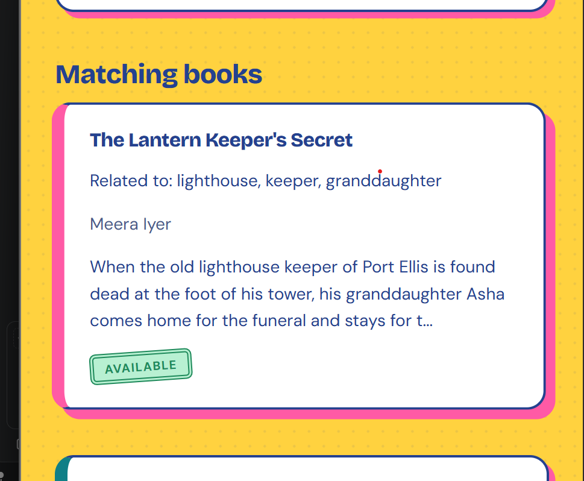
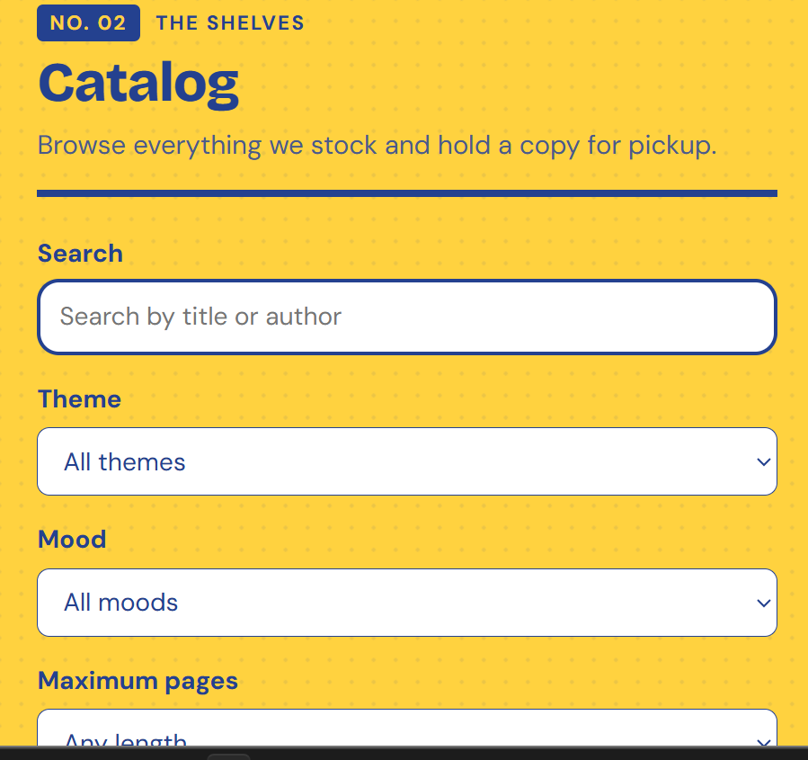
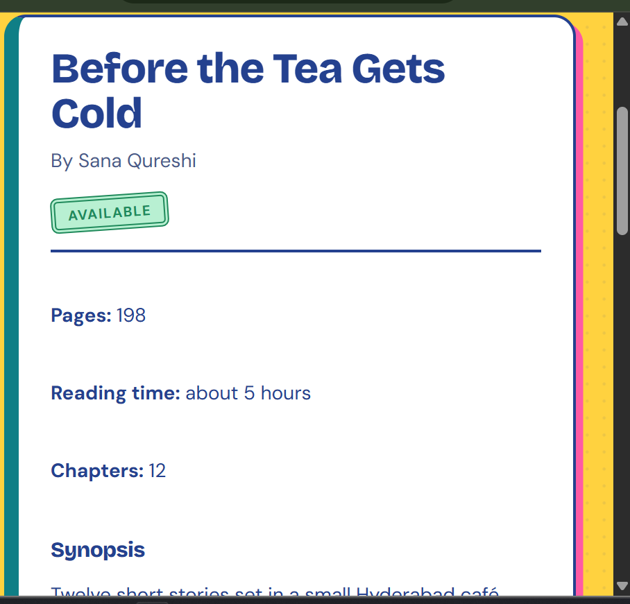
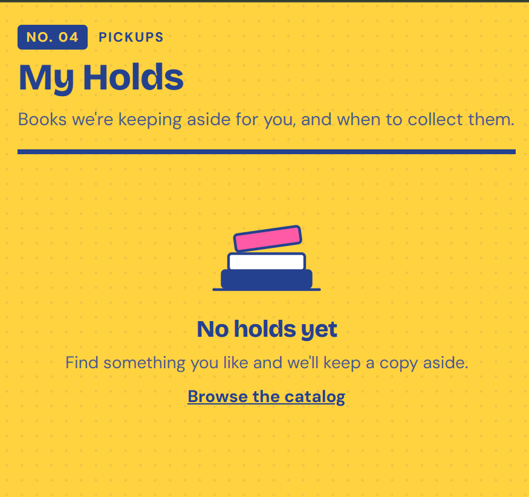
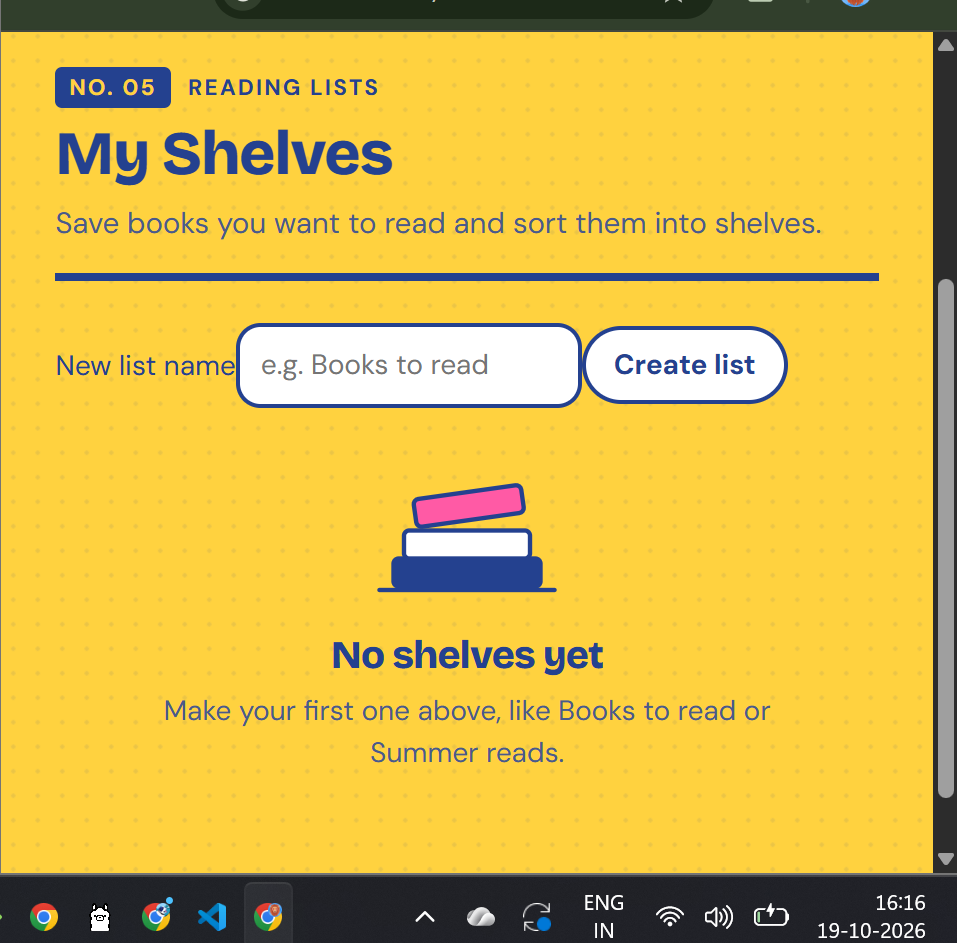
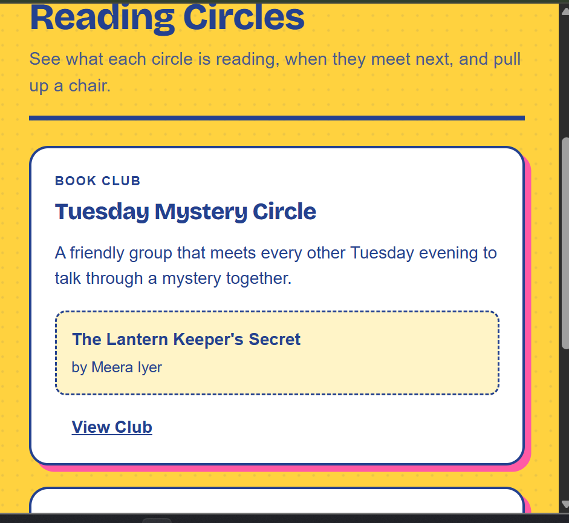
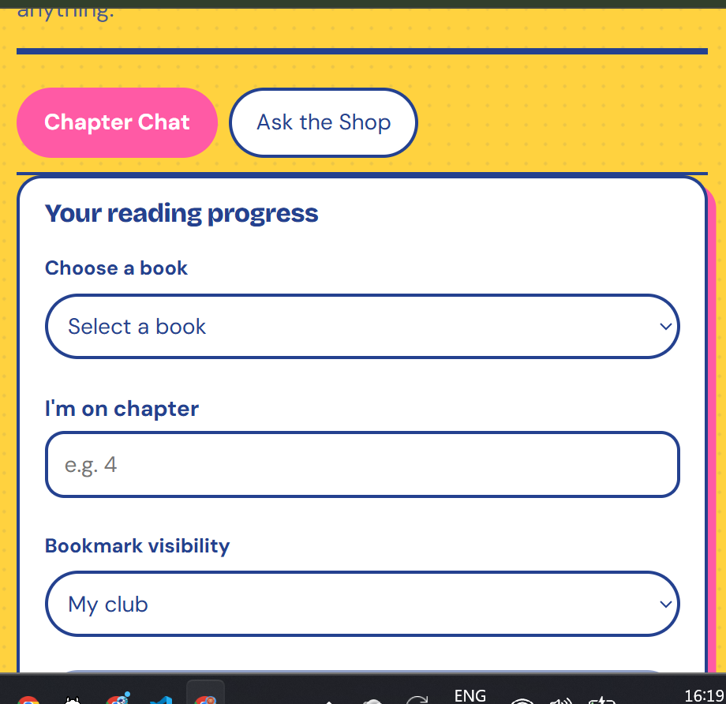
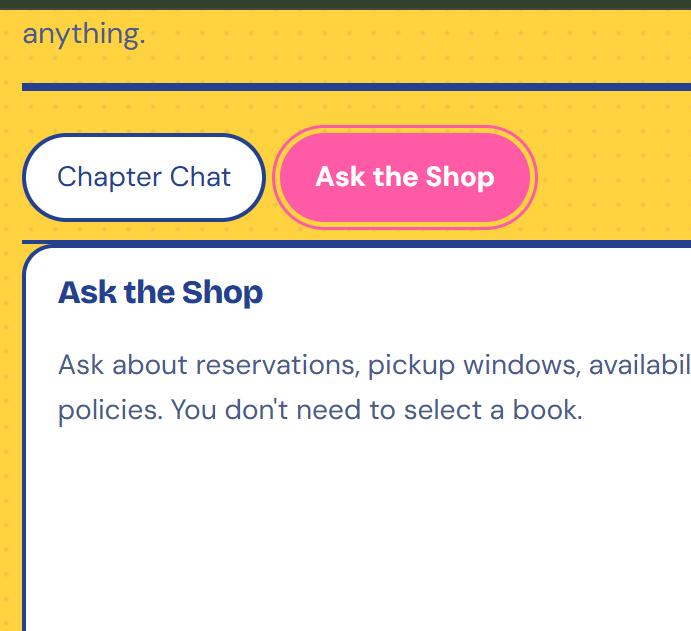

# Booklore Reader Guide

## Introduction

Booklore helps readers discover books, browse the catalog, manage reading lists, reserve books for pickup, join reading circles, and ask questions about books and store services.

## 1. Smart Search

Smart Search helps readers find a book by describing its story, characters, setting, or other details they remember.

**How to use it:**

1. Open Smart Search.
2. Enter a description of the book using at least three characters.
3. Click **Find books**.
4. Review the matching books, descriptions, and availability.

## 2. Catalog

The Catalog lets readers browse available books and filter the collection.

**How to use it:**

1. Open **Catalog**.
2. Search by book title or author.
3. Use the available filters, such as theme, mood, and maximum pages.
4. Browse the matching books.

## 3. Book Details

The book details page provides information to help readers decide what to read.

It may display the title, author, availability, page count, estimated reading time, chapter count, and synopsis.

**How to use it:**

1. Open the Catalog.
2. Select a book.
3. Review its details and availability.

## 4. My Holds

My Holds shows books being kept aside for a reader and information about collecting them.

**How to use it:**

1. Open **My Holds**.
2. Review your existing holds and pickup information.
3. To reserve a book, browse the Catalog and follow the available hold or reservation options.

If no holds exist, the page displays an empty-state message and a link to browse the Catalog.

## 5. My Shelves

My Shelves lets readers organize books into personal reading lists.

**How to use it:**

1. Open **My Shelves**.
2. Enter a name in the **New list name** field, such as “Books to read.”
3. Click **Create list**.
4. Use the available shelf controls to organize your reading lists.

## 6. Reading Circles

Reading Circles displays book clubs, their current reading selections, and links to club details.

**How to use it:**

1. Open **Reading Circles**.
2. Browse the listed clubs.
3. Review each club's description and current book.
4. Click **View Club** to explore a club's details.

## 7. Chapter Chat

Chapter Chat includes reading-progress and bookmark controls for tracking where you are in a book.

**How to use it:**

1. Open **Chapter Chat**.
2. Choose a book from the dropdown.
3. Enter the chapter you are currently reading.
4. Choose the bookmark visibility setting.
5. Use the available controls to save or update your progress.

## 8. Ask the Shop

Ask the Shop helps readers ask questions about store services without selecting a book first.

You can ask about reservations, pickup windows, book availability, and store policies.

**How to use it:**

1. Open **Chapter Chat**.
2. Select the **Ask the Shop** tab.
3. Enter your question in the available input area.
4. Submit the question and review the response.

## Troubleshooting

- **Smart Search validation error:** Enter a description of at least three characters.
- **No holds shown:** Browse the Catalog and use the available reservation options.
- **No shelves shown:** Create your first reading list using the New list name field.
- **Book not found:** Try another title, author, or description.
- **Page not loading:** Check that the application is running and refresh the browser.

## Screenshots

All screenshots referenced in this guide are stored in the `docs/screenshots/` directory.
