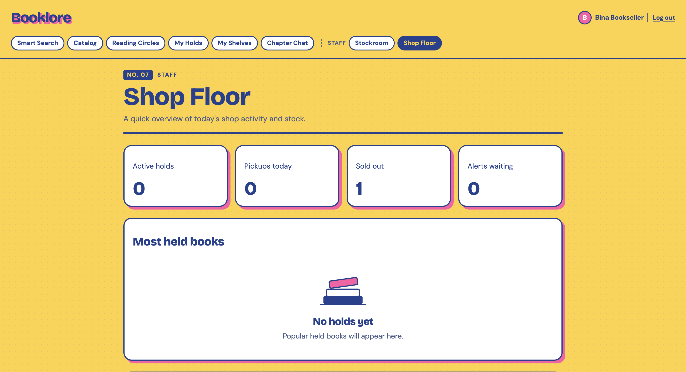
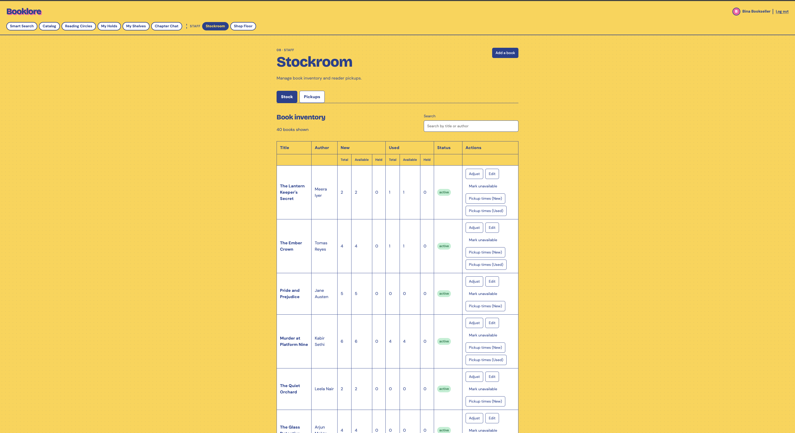
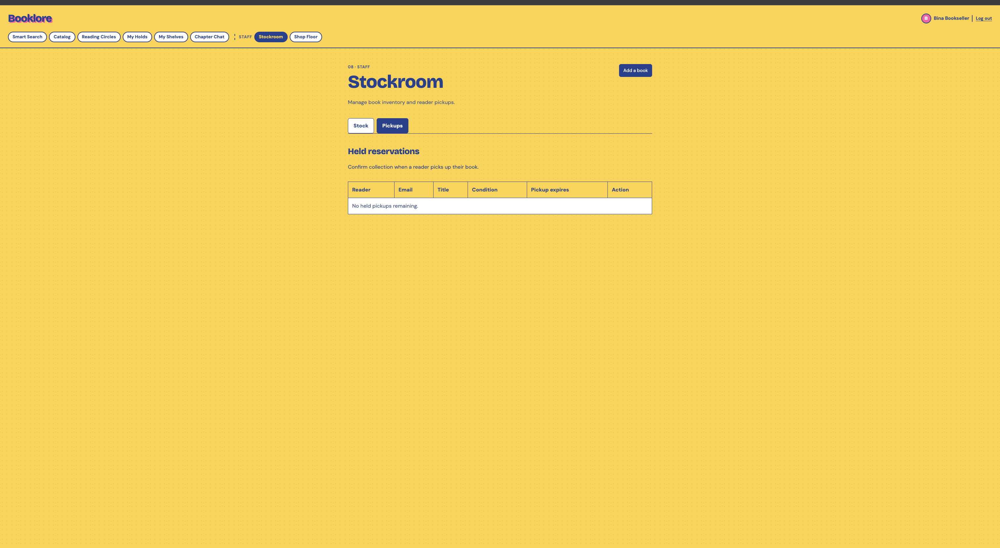
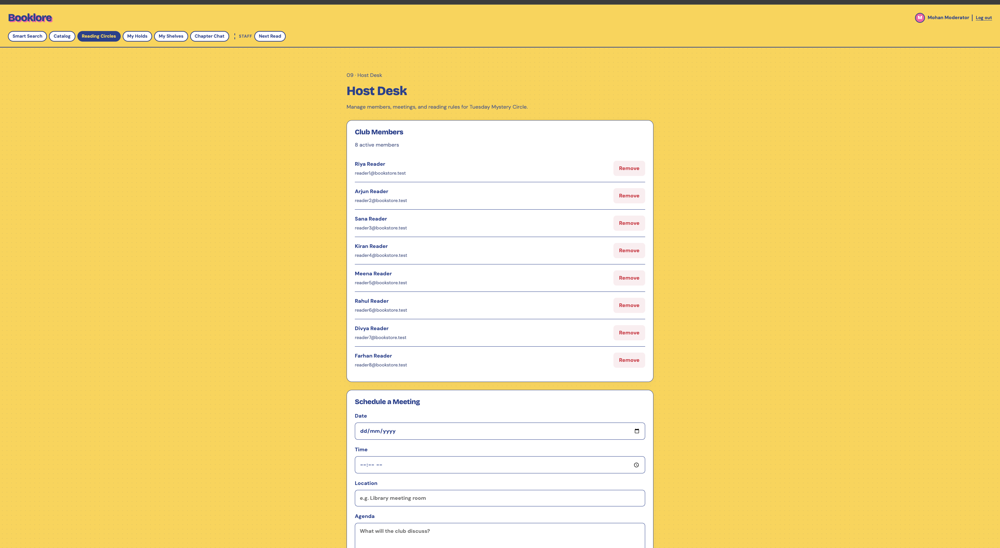
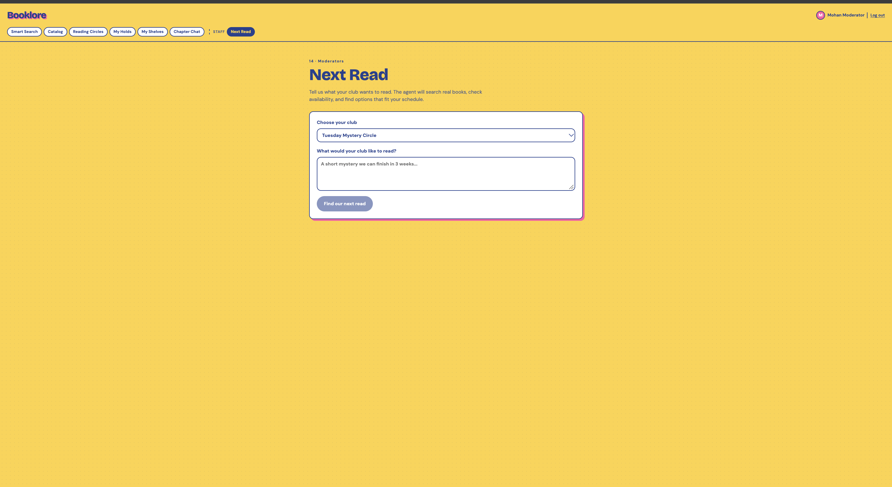
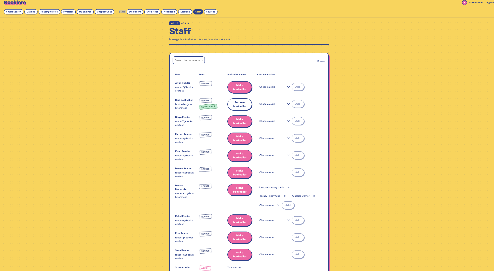
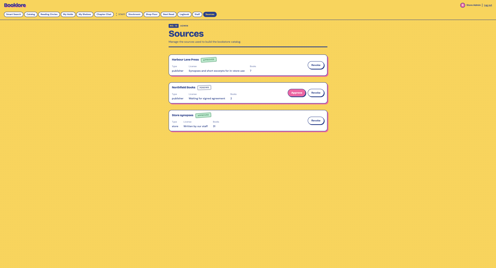
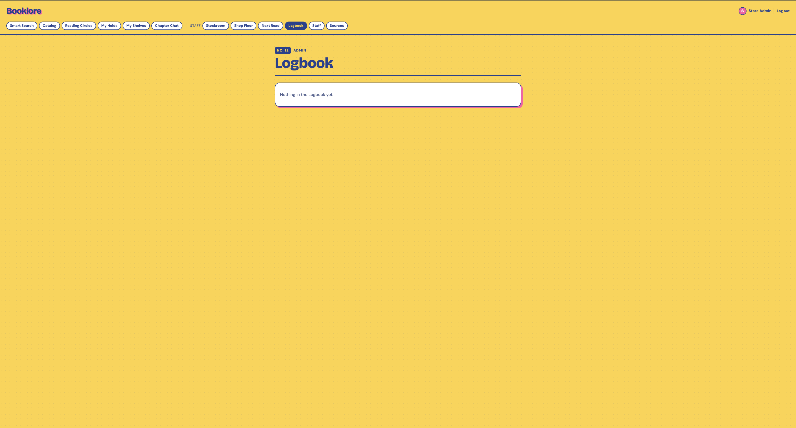

# Staff User Guide

This guide explains how booksellers, moderators, and administrators use the Bookstore Clubs application.

## 1. Bookseller

Sign in using the bookseller test account.

### Shop Floor

Use the Shop Floor page to browse and manage books available in the store.

### Stockroom

Use the Stockroom page to manage book stock, add books, and manage pickup windows.

### Pickups

Open the Pickups tab to find and collect a hold.

## 2. Moderator

Sign in using the moderator test account.

### Host Desk

Use Host Desk to manage members, meetings, rules, excerpt approvals, and Talking Points.

### Next Read

Use the Next Read page to review reading recommendations and related information.

## 3. Administrator

Sign in using the admin test account.

### Staff

Use the Staff page to manage staff roles.

### Sources

Use the Sources page to approve or revoke sources.

### Logbook

Use the Logbook page to review recorded activity.

